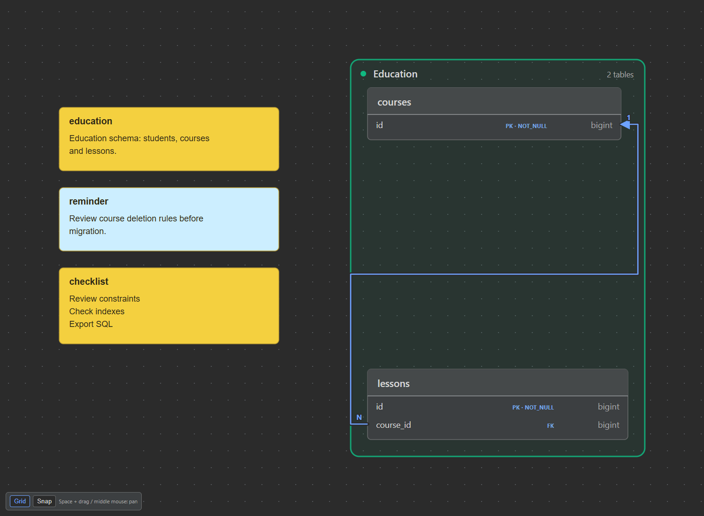
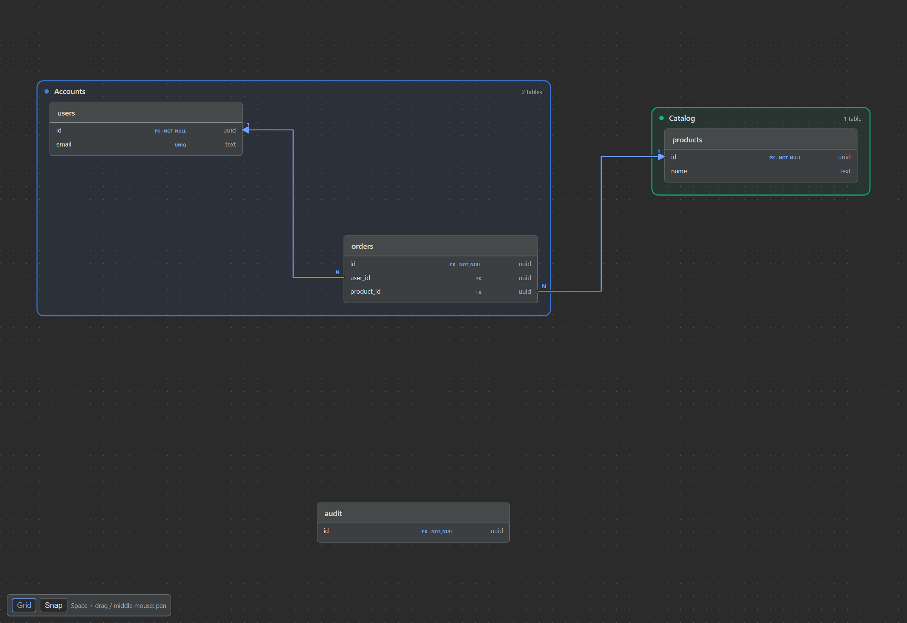
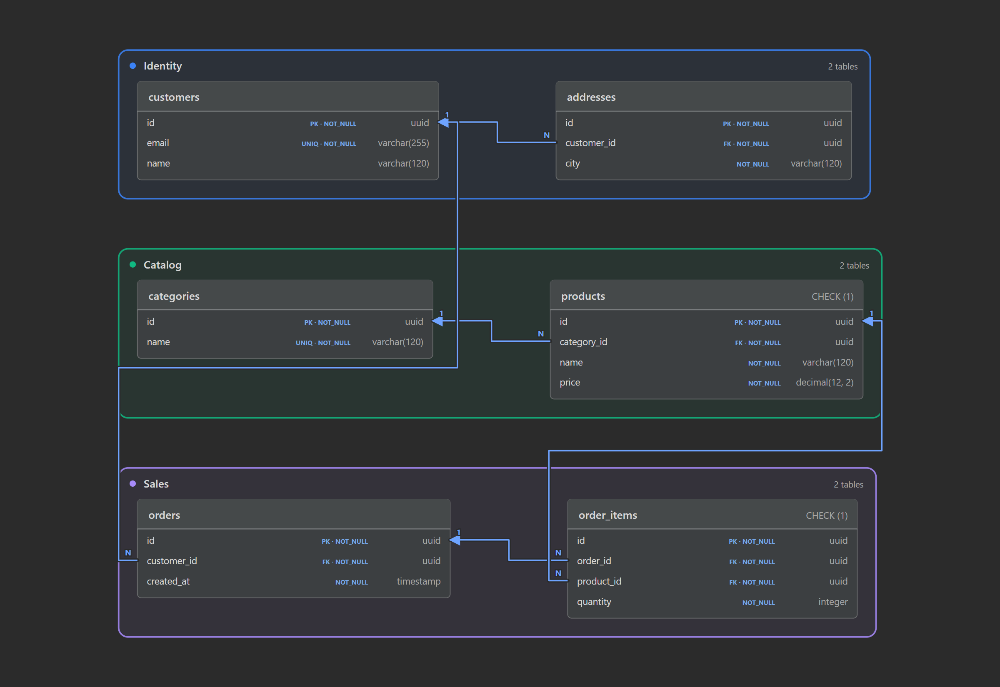

# DBML Diagram

[](https://github.com/RomanVoronovskiy/DBML_Diagram/actions/workflows/ci.yml)
[](LICENSE)
[](https://plugins.jetbrains.com/)

DBML Diagram is an open-source IntelliJ Platform plugin that shows a realtime SVG entity-relationship diagram next to a `.dbml` file. Version **2.2.0** adds **SQL → DBML import**, movable canvas Notes, and cleaner relationship routing. It supports Platform builds **241–262** (2024.1–2026.2) and retains the free SVG canvas, colored TableGroup frames, CHECK constraints, composite foreign keys, and optional dbdiagram.io synchronization. Local editing, preview, validation, and exports remain offline. It supports IntelliJ IDEA and DataGrip-compatible Platform IDEs.

## Features

- Standard IntelliJ text editor with **Code**, **Preview**, and **Code + Preview** modes.
- Debounced (300 ms), cancellable background parsing, layout, and SVG rendering.
- Reuse the most recent parse result when only the diagram layout changes, and skip superseded work between rendering stages.
- Last valid diagram remains visible while the document contains a parse error.
- Semantic relationship errors are underlined in the editor and drawn in red in the current diagram. Exports are disabled until the current document is valid.
- Free world coordinates, Space/middle-button/background panning, wheel scrolling, cursor-anchored Ctrl/Cmd + mouse-wheel zoom, Fit, zoom buttons, 100%, and manual Refresh.
- World-aligned dot grid with optional 24-unit snapping; per-file camera and navigation preferences.
- Drag tables by their headers; personal positions are restored per DBML file.
- Colored `TableGroup` frames with names, member counts, group-aware auto-layout, live resizing, and matching SVG/PNG exports.
- Whole-group movement by dragging its title band; table positions and internal route controls are saved together.
- Drag relationship lines to adjust their orthogonal route. A selected route has separate horizontal and vertical handles, while its endpoints can move between the top, right, bottom, and left table anchors.
- Full-diagram standalone SVG and PNG export. PNG rasterization uses Apache Batik and has a 16,384 px / 40 MP safety limit.
- PostgreSQL, MySQL, and Oracle DDL export with named primary, unique, and foreign-key constraints, indexes, defaults, comments, and referential actions.
- Visible `PK`, `FK`, `UNIQ`, and `NOT_NULL` markers on diagram columns.
- Named table-level CHECK constraints and repeated inline `check:` expressions, preserved in DDL exports and listed in table-header tooltips.
- Composite foreign-key tuples with whole-key validation, pairwise type checks, complete DDL column lists, and FK markers on every member. One relationship is drawn per constraint, anchored at the first declared column; the tooltip lists the full ordered tuple.
- Light and Darcula-aware diagram colors.
- DBML file type, icon, comments, and basic syntax highlighting.
- Triple-single-quoted multiline notes, including group notes in SVG tooltips. Standalone sticky `Note` blocks and project descriptions render as movable cards, included in SVG/PNG. Unknown declarations are skipped with warnings. The original text is not changed.
- Local PostgreSQL, MySQL, and Oracle SQL → DBML import through the separately installed official `@dbml/cli`.
- Optional dbdiagram.io browser login through the official CLI, or a workspace API token stored in IDE PasswordSafe.
- Search and select remote diagrams in **My Diagrams**, download DBML, link an existing file, and explicitly Pull or Push.
- Local editing, preview, validation, and SVG/PNG/DDL exports do not require an account, network access, Node.js, or CLI tools.

## SQL import and movable Notes (2.2.0)

### SQL → DBML

1. Install **Node.js 24 LTS** (the converter requires 18+) and run `npm install -g @dbml/cli`. This is separate from the optional cloud `dbdiagram` CLI.
2. Open **Tools → Import SQL to DBML…**, or **Import SQL** in a DBML preview, and select a `.sql` DDL file.
3. Choose **PostgreSQL**, **MySQL**, or **Oracle**. Node.js and `node_modules/@dbml/cli/bin/sql2dbml.js` are detected when possible; otherwise enter absolute paths. Use the JavaScript entry, not a `.cmd`/`.ps1` wrapper. Find its package directory with `npm root -g`.
4. Click **Convert**, then choose a separate `.dbml` output file. The IDE opens it with the usual preview. Unsaved SQL editor changes are included as input without modifying the source. Review any local-preview diagnostics before saving a partially supported conversion.

On Windows, install Node.js if necessary with `winget install --id OpenJS.NodeJS.LTS -e`, then reopen the terminal/IDE so PATH updates are visible. Verify `node --version` and `npm --version` before installing the converter.

Equivalent terminal commands (the plugin runs the converter locally in a temporary directory):

```shell
npm install -g @dbml/cli
sql2dbml schema.sql --postgres -o schema.dbml
# Other dialog choices: --mysql, --oracle
```

Try [the synthetic PostgreSQL example](examples/sql-import.sql): five tables, identity columns, an enum, defaults, a composite PK, a unique index, FK actions, and comments. The importer retains the converter's DBML and normalizes a unique FK to **1:1**, preserving constraint ownership; part of a composite PK is not unique by itself. Optional-side markers such as `<?` are accepted; the diagram still uses 1/N labels, with physical nullability from column settings.

Conversion uses the [official DBML CLI](https://dbml.dbdiagram.io/cli/) on your computer; it requires no account/database connection and does not execute SQL. Converter **10.2.0** was tested for this release. Conversion fidelity depends on the tool and SQL dialect: this is schema conversion, not a lossless SQL backup or migration executor. In the tested Oracle `ALTER TABLE ... FOREIGN KEY ... ON DELETE CASCADE` case, upstream 10.2.0 omits the delete action; restore it in DBML before exporting a migration. PostgreSQL/MySQL referential actions in the tested examples are preserved. Review generated DBML/DDL before a database migration. Import is cancellable, bounded to 8 MiB input/output and 120 seconds; conversion failures leave destination files untouched.

### Notes on the board

```dbml
Project learning {
  Note: 'Training platform: review retention rules before migration.'
}
Note reminder [color: #cef] {
  '''Review foreign keys
  Check indexes
  Export SQL'''
}
```

Standalone `Note name { 'text' }` and the project's `Note:` description appear in a column at the upper left of the tables. Drag a note by its card, text, or title to any world position; **Space + drag** still pans. Notes use the optional 24-unit Snap grid and have independent positions saved per file. Refresh/text edits retain those positions; Reset layout restores automatic placement. Positions do not rewrite DBML or synchronize to dbdiagram.io.

Notes support multiline text, `#rgb`/`#rrggbb` colors, and `color: none`. Cards wrap at approximately 38 characters and show up to 40 lines, with full text in the tooltip/editor. Fit and SVG/PNG export include notes; lines route around them. Table/column/group notes remain metadata rather than separate board cards.

Routing now removes redundant collinear out-and-back tails after moving tables, controls, or attachment sides. Handles on removed spurs are projected onto the remaining visible route. Selected attachment sides are preserved. Overlapping objects can still block routing.

Try [the public notes example](examples/canvas-notes.dbml). This screenshot comes from the real interactive preview:



## Free canvas navigation (2.1.0)

The preview is a free **SVG-based canvas**, not a replacement using the HTML Canvas raster API. Tables and route controls can move left/up through zero into negative world coordinates. Existing personal positions remain compatible.

| Action | Gesture |
| --- | --- |
| Pan anywhere, including over a card, relationship, or group header | **Space + left drag**, or **middle-button drag** |
| Pan from empty space | Left drag |
| Pan with a wheel/trackpad | Scroll; **Shift + wheel** pans horizontally |
| Zoom around the mouse cursor | **Ctrl/Cmd + wheel** |
| Move one table | Drag its header |
| Move a whole TableGroup | Drag its title or empty title band |
| Toggle the world grid / optional snapping | **Grid** / **Snap** in the bottom-left canvas controls |
| Show the current contents / center at actual size | **Fit** / **100%** in the editor toolbar |

Snap uses a 24-unit world grid, independent of zoom. A group moves by one shared delta, so member spacing is preserved. Internal relationship controls move with it; all lines are checked again for table obstacles. Moving a card into a frame does not change its membership: edit DBML for that. Shared membership/manual overlapping cards can still produce overlapping frames or blocked routes.

Camera position, zoom, grid/snap preferences, table positions, and routes are kept per DBML file in IDE workspace settings. Refresh and text edits retain the current camera. Resizing the panel retains zoom and the world point at the viewport center. **Reset layout** clears these settings and returns to automatic placement; it does not change source DBML.

Fit considers current content bounds, not the history of how far an object was dragged. SVG/PNG export includes the complete diagram (not just the viewport), cropping around tables, frames, and routes even when coordinates are negative or far from zero. The navigation grid is not exported. PNG retains its 16,384 px / 40 MP limit; spreading cards very far apart can still exceed that limit. Large layouts still require routing/rendering work; this is not a guarantee of unlimited diagram size. Layout multi-selection and Undo/Redo are not part of 2.1.0.



## Colored TableGroup frames (2.0.0)

Group tables into visual domains using [DBML TableGroup syntax](https://dbml.dbdiagram.io/syntax/enrichment-visualization/):

```dbml
Table customers { id uuid [pk] }
Table orders {
  id uuid [pk]
  customer_id uuid [ref: > customers.id]
}

TableGroup Identity [color: #3b82f6, note: 'Customer accounts'] {
  customers
}
TableGroup Sales [color: #a78bfa] {
  orders
}
```

- Use `#rgb` or `#rrggbb` colors; omitted/invalid colors fall back to a stable palette derived from the group name. Invalid colors produce a warning.
- Quoted names, schema-qualified table names, aliases, forward declarations, and `Note: '...'` / `Note { '...' }` inside a group are supported. Hover a group title to read its full name and note; very long visible names are shortened.
- Automatic layout packs group blocks separately and places ungrouped tables outside them. **Reset layout** clears personal positions/routes and applies the new group-aware layout. Previously saved table positions are respected until then.
- Drag **table headers** to move individual tables: the frame expands/shrinks immediately. In 2.1.0, drag the **group title band** to move all its members together. Frames do not constrain table movement, and moving tables into another frame does **not** change DBML membership. Edit the `TableGroup` body to change membership.
- SVG and PNG export include names, colors, frame bounds, and saved table positions. PNG size/memory safety limits still apply. A group's frame is visual background, not an obstacle for relationship lines.
- Unknown or duplicate members produce source-located warnings; empty/unresolved groups draw no frame. Multiple membership is warned about: the first group controls automatic placement and frames can overlap. Manual overlap is also retained, not silently rearranged.
- Groups do not change SQL output, create database schemas, or upload local layout settings to dbdiagram.io. Standalone sticky notes are rendered starting in 2.2.0.

Try [the public synthetic storefront example](examples/table-groups.dbml) (six tables, three domains, valid FK-to-PK arrows, and CHECK expressions). These screenshots are generated from the actual interactive preview, not an illustrative mockup:



[Light-theme preview](docs/images/table-groups-light.png). The example and screenshots can be reused for a future Habr walkthrough; no private reproduction schemas are included.

## CHECK constraints and composite keys (1.0.3)

The local parser accepts both `checks { ... }` and column settings such as ``[check: `quantity >= 0`]``. CHECK expressions must be nonempty backtick-quoted SQL expressions. Names and expressions are preserved when exporting PostgreSQL, MySQL, or Oracle DDL; SQL expression semantics are not evaluated or translated, so review expressions for the selected dialect. [MySQL CHECK enforcement](https://dev.mysql.com/blog-archive/mysql-8-0-16-introducing-check-constraint/) requires MySQL 8.0.16 or newer.

Composite references use the [DBML syntax](https://dbml.dbdiagram.io/docs/) `Ref: tasks.(department_id, tenant_id) > departments.(id, tenant_id)`. Column counts and positional types must match, the target tuple must form a complete PK/UNIQUE key, and FK uniqueness is checked across the entire tuple, including unique subsets. See [the public synthetic example](examples/checks-composite.dbml).

These are schema-processing improvements, not automatic database/schema tuning: the plugin does not rewrite your DBML, evaluate CHECK expressions, or execute SQL. TableGroup is visualized starting in 2.0.0, and standalone sticky notes in 2.2.0.

## dbdiagram.io integration (1.0.0)

Open **View | Tool Windows | dbdiagram.io**, or click **dbdiagram** in the DBML preview toolbar. Use **Connection…** to choose one of two authentication methods:

### Browser login — official CLI

1. Install Node.js **22.14 or newer** and run `npm install -g dbdiagram` in a terminal. The integration was developed against official CLI **0.6.3**.
2. Select **Browser login (official CLI)**. The plugin detects Node.js and `node_modules/dbdiagram/dist/index.js` when possible; otherwise enter their absolute paths. Do not select the `.cmd`/`.ps1` shim as the CLI entry.
3. Leave **Workspace ID** blank for your personal workspace, or enter a team workspace's ID.
4. Click **Login / Connect** and finish authentication in the browser opened by the official CLI. The plugin then loads **My Diagrams**.

The CLI manages its own global credentials; the plugin never reads that credentials file or your account password. **Disconnect** logs out the shared CLI account, including terminal use. An existing terminal CLI login can be reused with **Refresh** instead of logging in again. The plugin ignores inherited `DBDIAGRAM_TOKEN` and CLI host-override environment variables in this mode so browser credentials and official hosts are used consistently.

Each CLI operation runs in a private temporary directory with explicit diagram/file arguments. The plugin does not run `dbdiagram init`, execute project hooks, or change your repository's CLI settings, `.env`, or adjacent visualization files. Official CLI authentication and its own telemetry remain governed by the CLI/provider.

### Workspace API token — no Node.js required

1. In dbdiagram.io, open the relevant workspace and its **API Tokens** tab (shown in the website's My Diagrams window).
2. Generate a workspace token as the workspace owner.
3. Select **Workspace API token (no Node.js)**, paste it, save, and click **Login / Connect**.

The [public API](https://docs.dbdiagram.io/api/v1/) is currently beta and requires a paid plan. Tokens grant workspace-scoped access. This mode connects directly to the documented HTTPS API and requires neither npm nor the CLI. The token is stored using **IntelliJ PasswordSafe**, never in project files. Leaving the token field blank preserves the saved token; **Disconnect** removes it.

### Select, edit, Pull, Push

1. Search **My Diagrams** by name or ID; sort columns by clicking their headers. Select a diagram and click **Pull to file…** to download and open a `.dbml` file. The downloaded file is automatically linked.
2. Alternatively, open an existing `.dbml` file and click **Link to current DBML** for the selected diagram. **Link ID** in the preview toolbar also accepts an ID or `https://dbdiagram.io/d/...` URL. Linking records the remote baseline without replacing local content.
3. Edit DBML normally. **Pull** replaces local text only after confirmation, including unsaved edits, and is undoable in the editor. If the document changes during the download/confirmation, the operation stops without discarding edits.
4. **Push** sends the editor's current text, including unsaved edits, after confirmation. Before upload it fetches the remote DBML and compares it with the baseline from the previous Link/Pull/Push. If someone else changed it, upload is stopped: download into a separate file, merge manually, and relink before retrying.

Push updates the linked existing diagram, not a new diagram. It does not rename the diagram or upload the plugin's table positions/relationship routes. Website visualization settings are retained by omitting them from the update. No automatic synchronization, automatic push retry, diagram creation, deletion, or rename is performed. Empty local documents and DBML larger than 8 MiB are not pushed. If local parser errors exist, explicit confirmation is required because the cloud supports a wider DBML grammar; the server remains responsible for accepting or rejecting the DBML.

Changing the API token, using **Login** again, or disconnecting invalidates old bindings; relink files before syncing with a different account. If you change the shared CLI account outside the IDE, relink files manually as well. **Refresh** reuses the current account without invalidating bindings.

The public API/CLI does not provide an atomic compare-and-swap update: another writer could still change the diagram between the final check and upload. The check reduces accidental overwrites but is not a distributed lock. Coordinate simultaneous edits. If a push times out/is canceled, its server outcome may be uncertain; inspect the remote before retrying.

The list shows the diagrams accessible to the selected CLI workspace or API token. Metadata unavailable from that backend is shown as `—` (for example, the CLI does not return creation dates). Team workspace selection currently uses a workspace ID in Connection settings, not a website-style workspace dropdown. See [PRIVACY.md](PRIVACY.md) for data handling.

## Build

Requirements: JDK 17 and network access for the first Gradle dependency download.

The build uses Gradle **9.7.0**, Kotlin **2.4.21**, IntelliJ Platform Gradle Plugin **2.19.0**, and Apache Batik **1.19**. Java bytecode remains targeted to 17, and source/API language levels remain 2.0. The core compiles against Kotlin stdlib **1.9.22**, matching the oldest supported IDE; Kotlin is supplied by the host IDE, not duplicated in the plugin ZIP. The Gradle distribution is pinned with its official SHA-256 checksum, and the local build cache is enabled.

```bash
./gradlew test
./gradlew buildPlugin
./gradlew :dbml-intellij-plugin:testPackagedPlugin
```

`testPackagedPlugin` checks the actual ZIP libraries in an isolated child-first classloader and rasterizes a PNG, guarding against bundled XML APIs that conflict with IntelliJ. For preview interaction geometry, run `node dbml-intellij-plugin/src/test/js/preview-routing.test.cjs` (Node is needed only for this optional test).

With Playwright and a Chromium browser installed, `node dbml-intellij-plugin/src/test/js/preview-pointer.test.cjs` checks actual pointer events, attachment clicks, zoomed dragging, persistence messages, and live obstacle avoidance using the HTML generated by the Gradle tests. Set `DBML_BROWSER_CHANNEL=msedge` to test with installed Microsoft Edge instead of Playwright Chromium.

`node dbml-intellij-plugin/src/test/js/preview-groups.test.cjs` checks light/dark group rendering, label bounds, repeated/zoomed table dragging, live frame expansion/shrink, and restored positions. Gradle tests generate the public showcase's SVG/PNG/HTML under `dbml-intellij-plugin/build/reports/table-groups/`; the browser test adds `table-groups-light.png` and `table-groups-dark.png` screenshots there. Playwright is a test-only dependency, not required to use the plugin. Install it in a separate tooling environment with `npm install playwright` and `npx playwright install chromium`, or use your existing installation through `NODE_PATH`. Do not install npm tooling into the plugin repository just to use local preview/export.

`node dbml-intellij-plugin/src/test/js/preview-canvas.test.cjs` exercises real-pointer free-canvas navigation, negative table positions, atomic/repeated group dragging, Space/middle/wheel panning, anchored zoom, grid/snap, Fit, resize, restored camera, and per-animation-frame rerouting. Gradle generates synthetic SVG/PNG/HTML fixtures under `dbml-intellij-plugin/build/reports/free-canvas/`; the browser test adds light/dark screenshots and the actual group-move payload there. These are synthetic examples, not private user diagrams.

By default, `verifyPlugin` checks IDEA 2024.1.7, 2025.2.6, and 2026.2.3. To verify installed IDEs instead, run `./gradlew :dbml-intellij-plugin:verifyPlugin -PverifyLocalIde="/path/to/IDE"`. The local override avoids downloading the default matrix. Multiple local IDE paths may be separated by the operating system's path separator (`;` on Windows, `:` on Unix). Use `--offline` once build dependencies are cached.

## Dependency audit — 1.0.1

Reviewed on 2026-10-14, including open Dependabot PRs #5–#9:

| Dependency | Previous | Selected | Decision |
| --- | --- | --- | --- |
| Apache Batik codec/transcoder | 1.17 | 1.19 | Apply both coordinated bumps; keep all Batik modules aligned. |
| IntelliJ Platform Gradle Plugin | 2.2.1 | 2.19.0 | Migrate the verification DSL and update the build toolchain together; PR #6 failed CI as an isolated update. |
| Kotlin compiler/plugin | 2.0.21 | 2.4.21 | Use the current patch release, with existing source/API level and the oldest supported IDE's stdlib. |
| Gradle | 8.10.2 | 9.7.0 | Meets JetBrains plugin requirements and Kotlin's fully supported range; do not apply the 9.8.0 bot proposal independently. |
| JUnit (plugin tests only) | 4.13.2 | 4.13.2 | Retain the test framework used by the oldest supported IDE. |

Batik 1.19 resolves XML Graphics Commons 2.11, Commons IO 2.17.0, Commons Logging 1.3.0, and SVG-specific `xml-apis-ext` 1.3.04. These remain the upstream-declared dependency set; IDE-owned Kotlin, Gson, JAXP, DOM, and SAX classes are not independently upgraded or bundled. `xml-apis` remains excluded to prevent the installed-plugin PNG classloader regression. The distribution smoke test checks actual shipped libraries, including nested module JARs, and rejects bundled Kotlin runtimes. A point-in-time [OSV](https://osv.dev/) query for all **22 shipped third-party Maven packages** returned no known advisories on 2026-10-14; IDE-supplied libraries and the external CLI are outside that query's scope.

PNG export rejects DTD/entity declarations before XML parsing, denies all external resources through Batik's user agent, and disables on-load scripts. Regression tests cover these boundaries alongside valid diagram rasterization. This is a targeted dependency/compatibility audit, not a certification that no undiscovered vulnerability exists.

Dependabot now groups Batik updates and build-toolchain updates separately, reducing duplicate or individually incompatible bump PRs. No bot PR is automatically merged by the plugin project.

The plugin uses JVM default-method inheritance without generating Kotlin `DefaultImpls` forwarders to internal IDE methods. A regression test guards the tool-window factory's compiled method set. Legacy public API deprecation warnings are retained where needed for the supported 2024.1 baseline; verifier findings are not suppressed.

Sources: [JetBrains build tool requirements](https://plugins.jetbrains.com/docs/intellij/tools-intellij-platform-gradle-plugin.html), [Kotlin/Gradle compatibility](https://kotlinlang.org/docs/gradle-configure-project.html), [IDE-bundled Kotlin versions](https://plugins.jetbrains.com/docs/intellij/using-kotlin.html), [Apache Batik releases](https://xmlgraphics.apache.org/batik/download.cgi).

The installable ZIP is produced under:

```text
dbml-intellij-plugin/build/distributions/
```

## Run sandbox IDE

```bash
./gradlew runIde
```

Open or create a `.dbml` file in the sandbox IDE. The editor mode selector is provided by IntelliJ's standard `TextEditorWithPreview` component.

## Install locally

1. Run `./gradlew buildPlugin`.
2. In IntelliJ IDEA or DataGrip, open **Settings | Plugins**.
3. Choose the gear menu, then **Install Plugin from Disk…**.
4. Select the ZIP from `dbml-intellij-plugin/build/distributions/` and restart the IDE.

## Architecture

```text
dbml-core
├── model       immutable schema and diagnostics
├── parser      tolerant, IntelliJ-independent DBML parser
├── layout      DiagramLayoutEngine + deterministic layered layout
├── renderer    DiagramRenderer + standalone SVG renderer
└── ddl         PostgreSQL, MySQL, and Oracle DDL generators

dbml-intellij-plugin
├── language    file type, commenter, lexer/highlighter
├── editor      standard text editor + preview composition
├── preview     debounce scheduler, JCEF UI, SVG/PNG export
└── cloud       optional official API/CLI clients, credentials, bindings, My Diagrams
```

The parser never calls the renderer. `DbmlSchema` is immutable and suitable for a future semantic diff. Layout is behind `DiagramLayoutEngine`, so ELK or another engine can replace the current dependency-free layered algorithm without changing parsing or preview code. JCEF receives only generated, self-contained HTML/SVG.

## Supported DBML subset

- `Project`, `Table`, schema-qualified and quoted table names, aliases, and table notes.
- Columns with arbitrary type strings, including parameterized numeric/varchar types.
- `[pk]`, `[not null]`, `[null]`, `[unique]`, `[increment]`, `[default: ...]`, and `[note: ...]`.
- Simple and composite `indexes` with `unique` and `name` settings.
- `Enum` values.
- `Ref:` and named `Ref { ... }` using `>`, `<`, `-`, and `<>` cardinalities.
- Reference settings such as `[delete: cascade]` and `[update: no action]` are accepted and translated where the selected SQL dialect supports them.
- Inline column `[ref: ...]` references.
- `//` line comments and `/* ... */` block comments.
- Warnings for duplicate tables/columns; errors for unknown reference tables/columns and invalid relationships.

## Relationship validation

The plugin validates single-column relationships against declared constraints:

- `>` / `<` (N:1 / 1:N): the referenced side must have a single-column PK or UNIQUE constraint, and the many-side FK must not be individually unique.
- `-` (1:1): both endpoints must be individually unique. A shared-primary-key relationship is valid; add `[unique]` to a non-PK FK to declare uniqueness explicitly.
- `<>` (N:N): both endpoints must identify entities through single-column PK/UNIQUE constraints. This is a conceptual relationship, so different entity key types are allowed. SQL export still requires an explicit junction table.
- Direct FKs require compatible type families. Unknown endpoints and a column referencing itself are errors; hierarchical self-references between distinct columns are allowed.
- A column inside a composite PK or UNIQUE index is not considered unique by itself. A separate single-column UNIQUE constraint can make it a valid referenced key.

Invalid `Ref` expressions (including inline settings) receive an editor error underline with an explanation. The preview displays invalid relationships as red dashed lines and highlights affected columns/tables; unresolved relationships are listed in the diagnostic banner. DDL, SVG, and PNG exports are blocked while errors remain. Syntax errors retain the previous diagram, but never permit export of stale data.

## DDL export

Choose **PostgreSQL**, **MySQL**, or **Oracle** next to **DDL dialect**, then use **Export DDL** to save the latest valid schema as a `.sql` file. The first selection follows `Project.database_type` when it names a supported dialect. The exporters translate identifiers, types, enum representation, identity/auto-increment syntax, comments, and referential actions for the selected database.

Diagram relationships attach to the actual column rows on the left/right table sides by default, are drawn from the physical foreign-key column toward the referenced column, and are labelled `N → 1` or `1 → 1`. Row alignment is retained when tables move and in SVG/PNG exports. Manually selected top/bottom attachments remain table-border anchors; hovering a relationship always shows the exact column endpoints. Column constraints are shown between the column name and SQL type as `PK`, `FK`, `UNIQ`, and `NOT_NULL`.

Drag a table by its header to create a custom layout. Positions are stored in the IDE workspace for that DBML file, survive preview refreshes, and are applied to exported SVG and PNG files. Use **Reset layout** to discard them and return to the automatic layered layout.

Drag a relationship line or its central handle to move the routing control point freely. Selecting the line also reveals a horizontal handle for moving the route only left/right, a vertical handle for moving it only up/down, both endpoint handles, and all four attachment points on the related tables. Drag an endpoint to choose another side, or click a small attachment point directly. Routes are rebuilt around table cards when any table moves; unsafe control points inside a card are moved to a free position. Routes are stored alongside table positions and used for SVG/PNG export. Overlapping cards or extremely large blocked routing grids can prevent a collision-free route; separate overlapping tables before adjusting their routes.

The toolbar wraps onto additional rows in narrow preview panels so **Export PNG** and the other export actions remain visible.

Many-to-many `<>` relationships require an explicit junction table in DBML; the generated SQL includes a comment when such a relationship cannot be represented as a direct foreign key.

## Known limitations

- This is a tolerant subset parser, not a complete DBML grammar or PSI implementation.
- The built-in layered layout is deterministic and fast, but does not perform advanced edge crossing minimization for very dense cyclic schemas.
- Visualization-only relationship settings such as colors are currently ignored.
- JCEF must be enabled in the host IDE for the visual preview; the code editor remains available if JCEF is unavailable.
- Syntax highlighting is lexical only; navigation, completion, inspections, and refactoring are not included.
- A temporarily incomplete custom type is accepted when it is syntactically a valid type token; an unclosed block/settings/string is reported as an error.

## Contributing

Contributions are welcome. Please read [CONTRIBUTING.md](CONTRIBUTING.md), follow the [Code of Conduct](CODE_OF_CONDUCT.md), and report vulnerabilities according to [SECURITY.md](SECURITY.md).

The project is released under the [Apache License 2.0](LICENSE). Changes are tracked in [CHANGELOG.md](CHANGELOG.md).

## Roadmap

Future work may add DBML PSI, completion/navigation/refactoring, ELK layout, richer visual editing, Git history, and semantic schema diff.
